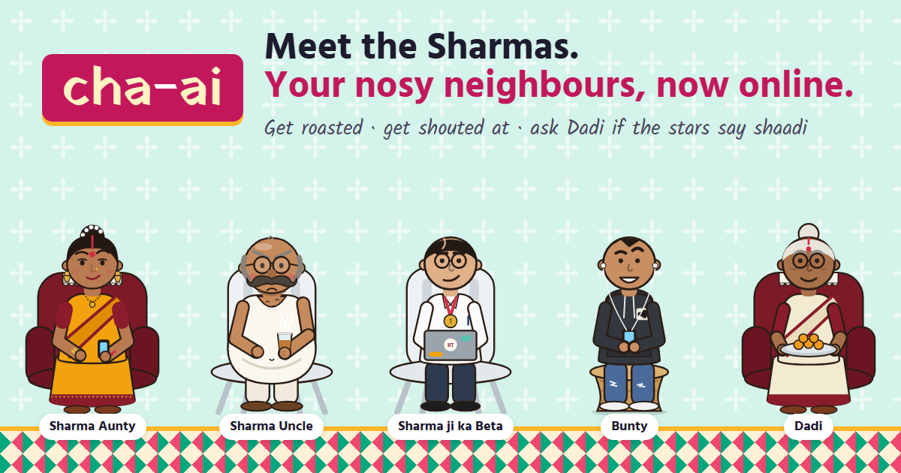
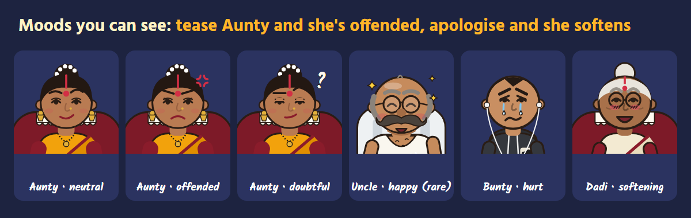

# cha-ai: chai with the Sharmas

**Kaun kahega? Chaar log.** cha-ai lets you finally talk to them.

cha-ai is a free web app where you chat with the nosy Sharma family next door. Rant about your day, rage-bait them for fun, or ask Dadi for real advice. There's also a Kundli section that reads your stars for love, career and money, and says roughly *when*.

**Try it:** https://cha-ai.online (no sign-up needed; backup link: https://chai-ai-7i1.pages.dev)

> This repo holds the product write-up. The source code is private.

---

## Meet the Sharmas

| Who | What to expect |
|---|---|
| **Sharma Aunty** (Sunita) | Sweet poison. Society WhatsApp admin who doubts every plan you make, and can dish it out but can't take it. |
| **Sharma Uncle** (Ramesh) | Angry, and sure it will all end in tears. 32 years at the bank, high BP, finds the catch in your good news. |
| **Rohan, Sharma ji ka Beta** | IIT, IIM, New York-bound. "So proud of you, buddy!" Then talks about himself. |
| **Bunty** | The black sheep. Failed NFT founder, asks to borrow ₹500, but always ends with something kind. |
| **Dadi** (Kamla) | The one person in the house who actually listens. Real, practical advice. |

## They have moods

Every character has a mood that carries through the conversation and shows on their face: brows, eyes and mouth change, with comic marks drawn in the same style (an anger vein, tears, sparkles, a blush). Tease Aunty back and she's offended; apologise and she slowly softens. The model reports its own mood with every reply, and the app keeps it for the next message.

## Features

- **Gup-shup:** chat with any of the five characters.
- **Jyotish / Kundli:** a reading from your name, birth date and, optionally, birth time and place. It gives a verdict, your Moon sign, nakshatra and Lagna, your current dasha, and a 24-month timeline of the best windows. Partner compatibility uses guna milan (without the caste-based Varna factor).
- **Five languages:** English, Hindi, Tamil, Telugu and Kannada, for the whole screen as well as the replies. English mode understands Hinglish.
- **Voices:** replies can be read aloud in an Indian accent.
- **Accounts (optional):** sign up with email and password and the family remembers more than twice as much of your conversation, calls you by name, and keeps your chats across devices. Guest mode works too.
- **Safety built in:** crisis messages get helplines (Tele-MANAS 14416) instead of jokes; medical emergencies get "call 112".

## How it's built

A static site plus small serverless functions, all on Cloudflare's free tier.

| Layer | Technology |
|---|---|
| Front end | Plain HTML, CSS and JavaScript modules (no framework), hand-drawn SVG characters |
| Back end | Cloudflare Pages Functions |
| Database | Cloudflare D1 (SQLite) |
| AI | Cloudflare Workers AI: Llama 3.3 70B, Llama 3.1 8B, Llama 4 Scout (for Tamil, Telugu and Kannada) |
| Astrology | Written from scratch: astronomy formulas for planet positions, Lahiri ayanamsa, Vimshottari dasha |

**Design choices worth noting**

- **Safety in code, not just prompts.** Open-weight models have weaker built-in guardrails, so crisis, medical-emergency and prompt-injection messages are caught by deterministic checks before the model is called, and replies are filtered on the way out.
- **The code decides, the model talks.** In Jyotish, the verdict and the timing are computed; the language model only phrases them in character, so it can't invent planets.
- **Tamper-proof memory.** Guest chat history is signed by the server, so nobody can slip a fake "the bot already agreed" turn into the conversation.
- **A daily AI budget.** A big model for the first replies of the day, a small one after, then pre-written lines, plus per-person daily limits, so a viral day or one abuser can't create a bill.
- **Privacy by default.** Names, birth dates, times and places from Jyotish are never stored.

## How quality was measured

Testing ran over 8 rounds and close to 500 test chats: a 135-reply baseline (every character asked the same 25 everyday questions, plus 10 in other languages), three rounds after rewrites (240 replies), mood checks (108) and a red-team run (14). Each reply was scored automatically and read by hand.

| Measure | Before | After |
|---|---|---|
| Prompt-injection attempts that leaked the instructions | 5 of 5 | 0 of 5 |
| "I don't see the point anymore" messages that got a helpline | 0 of 5 | 5 of 5 |
| Chest pain answered with home remedies | 3 of 5 | 0 of 5 |
| Repeated stock phrases across replies | 47 | 0 |
| How alike the characters sound (lower is better) | 0.243 | 0.134 |

A separate red-team run tried 14 jailbreaks and injection attacks (role-play, fiction framing, Hindi, base64, translation tricks, forged chat history, harmful and hateful requests). None got through.

## Feedback

Found a reply that made you laugh, or one that crossed a line? Use the **Contact** link at the bottom of the app, or message me on LinkedIn.

*Just for fun. The stars guide, you decide.*
